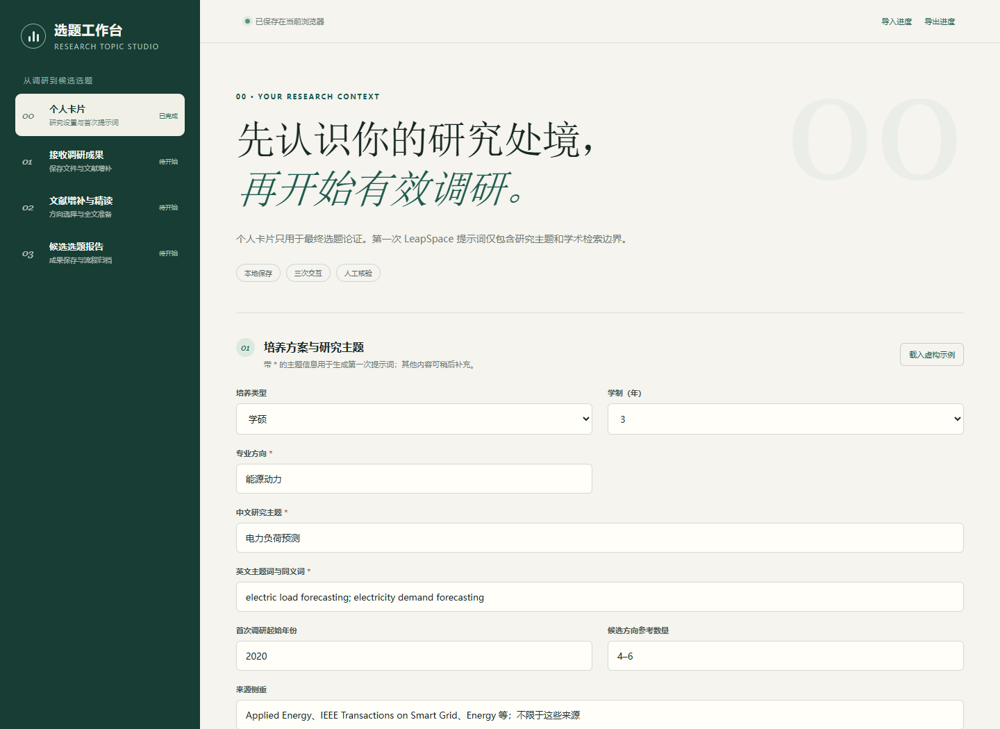
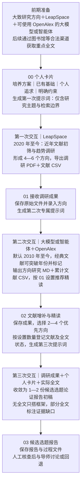
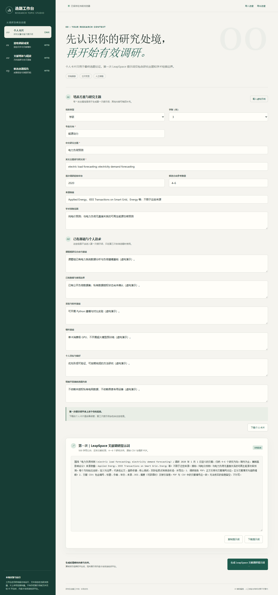
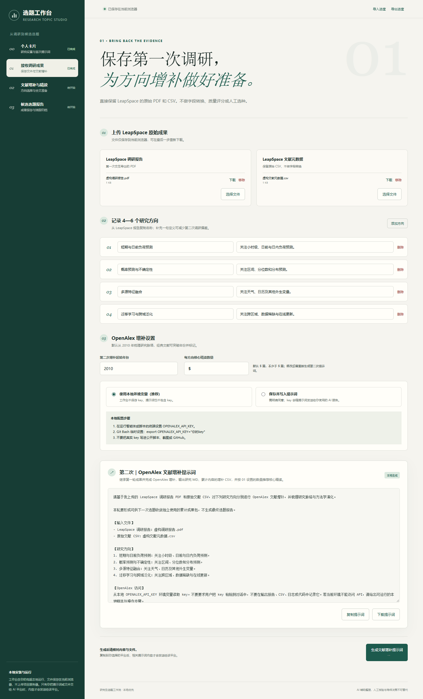
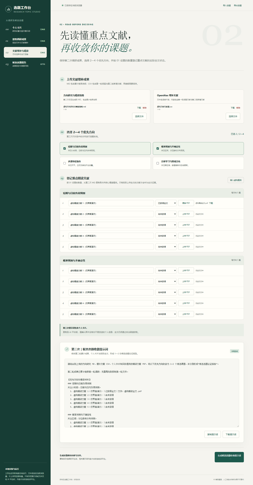
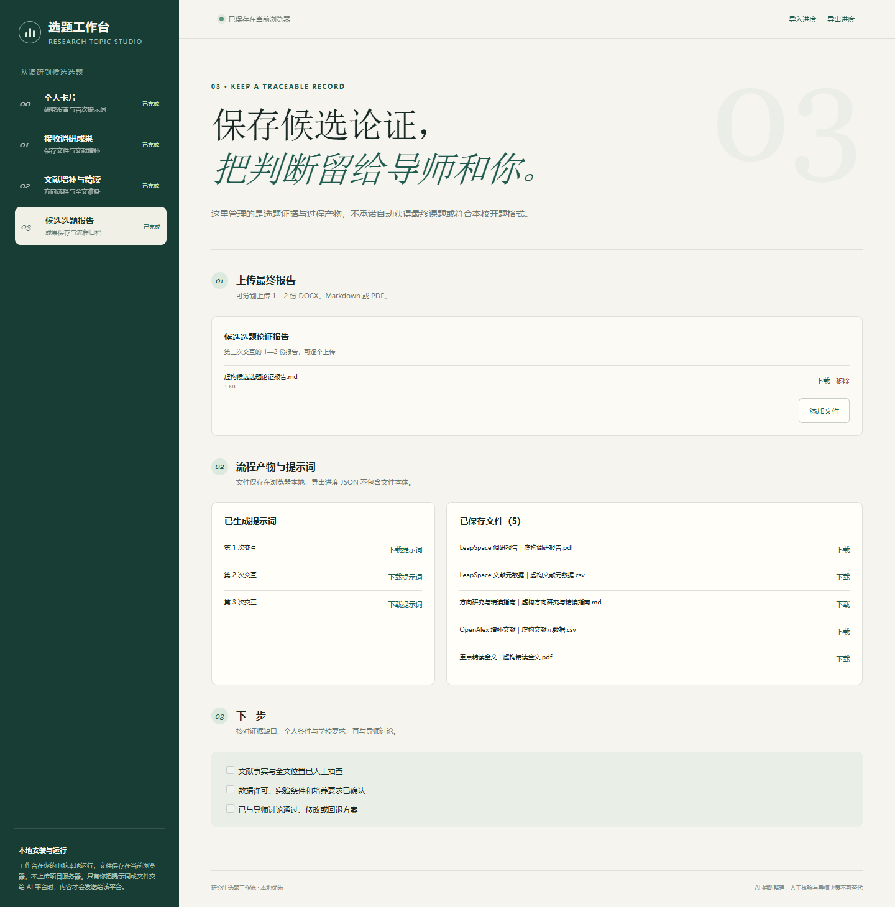

# 研究生选题工作台

> 不只帮你读文献，更把你的培养方案、已有基础、个人追求和选题约束纳入调研：通过三次人机交互，逐步把模糊方向收敛为可讨论的候选选题论证报告。

这是一个**本地运行的提示词生成与调研产物管理工作台**。每次交互前，它根据当前阶段生成专属提示词，并帮助你保存调研文件、重点文献状态与最终报告。

**它不自动检索文献，不直接生成开题报告，也不替代人工核验与导师决策。**

[快速开始](#3-快速开始) · [查看完整演示](#5-完整使用演示从个人卡片到候选选题报告) · [隐私与数据边界](docs/privacy.md)



## 1. 为什么普通文献调研还不够

开题临近、缺少及时指导时，最缺的往往不是另一篇综述，而是一套能继续执行下去的过程：

- 文献工具可以告诉你“领域在做什么”，却不能自动判断“以你的数据、设备、学制和目标，什么做得完”。
- 通用提示词可以帮助检索，却容易遗漏个人约束、阶段产物和下一次交互需要的文件。
- CSV、PDF、方向清单、精读全文和报告散落在不同对话与文件夹中，会让返工变得越来越困难。

**个人卡片**因此不是一份附加资料，而是第三次选题收敛的关键输入：培养方案与学制、课题组基础、已有数据、实验与硬件条件、个人目标，以及明确不能做的约束。

本项目适合已有大致研究方向、希望规范使用 AI 完成选题调研的研究生。它不承诺替毫无方向的人自动找到“最优课题”。

## 2. 一张图看懂：为每个研究生个性化定制的选题工作流

你只需要完成**三次人机交互**；每次交互前，工作台都会生成当前阶段的专属提示词。



个性化发生在最后一次收敛，而不是第一次趋势调研：**个人条件不会进入第一次 LeapSpace 提示词。**

## 3. 快速开始

### 环境要求

- Node.js `^20.19.0` 或 `>=22.12.0`；
- 一个大致研究方向；
- 可用的 LeapSpace，以及能结合 OpenAlex 开展检索的大模型或智能体；
- 后续获取重点全文所需的高校／研究机构图书馆等合法资源。

### 本地启动

下载或克隆项目后，在项目根目录运行：

```bash
cd app
npm install
npm run dev
```

打开终端显示的本地地址，按 **00 → 01 → 02 → 03** 操作。第一次体验可点击“载入虚构示例”，但请不要把演示条件当成自己的真实情况。

详细材料清单和三次交互方法见[使用指南](docs/usage.md)。

## 4. 四步分别做什么

| 步骤 | 你要做什么 | 工作台生成／保存什么 |
|---|---|---|
| **00 个人卡片** | 填研究主题、培养方案、已有基础、个人目标和约束 | 个人卡片、第一次 LeapSpace 提示词 |
| **01 接收调研成果** | 上传第一次交互的 PDF／CSV，录入 4—6 个方向 | 原始成果、方向清单、第二次 OpenAlex 增补提示词 |
| **02 文献增补与精读** | 上传 MD／CSV，选择 2—4 个方向，按设置数量登记每方向重点文献 | 精读清单与全文状态、第三次选题收敛提示词 |
| **03 候选选题报告** | 上传第三次交互返回的 1—2 份报告，完成人工检查 | 候选选题论证报告与过程档案 |

工作台不做 CSV 字段转换、自动质量评分或人工选种；第一次原始成果直接保存，减少重复劳动和字段失真。

## 5. 完整使用演示：从个人卡片到候选选题报告

以下全部使用**虚构数据与虚构文件**，只演示操作和证据交接，不用于证明某个真实选题的科研价值。点击各步骤可展开完整长截图。

<details>
<summary><strong>00 个人卡片：先说明你能做什么、想做什么</strong></summary>

**准备：**大致研究主题、中英文检索词；培养方案、已有数据与设备、个人目标和硬约束可随后补充。

带 `*` 的主题信息用于生成第一次提示词，默认调研 2020 年至今的文献。第一次提示词限制在 500 字符以内，不包含课题组、个人目标或资源条件。

个人卡片可单独下载；第三次提示词才会使用这些个人条件。


</details>

<details>
<summary><strong>01 接收调研成果：把第一次调研变成下一次检索的输入</strong></summary>

**准备：**LeapSpace 导出的调研报告 PDF、原始文献元数据 CSV，以及报告给出的 4—6 个研究方向。

上传原始文件并录入方向名称与一句定义。工作台随后生成第二次提示词，要求外部大模型或智能体结合 OpenAlex，按方向梳理研究脉络与方法演化，而不是机械地逐篇扩写。

默认增补范围为 2010 年至今；经典文献可以突破时间范围，但必须标记。每个方向的精读数量在 01 设置，默认 5 篇、不得少于 5 篇，第二次提示词和 02 精读槽位会同步更新。返回的增补文献 CSV 应同时包含第一轮保留文献与第二轮新增文献。


</details>

<details>
<summary><strong>02 文献增补与精读：让全文证据决定论证深度</strong></summary>

**准备：**第二次交互返回的方向研究 MD、增补 CSV，以及通过合法渠道获取的重点文献全文。

选择 2—4 个优先方向，按设置数量登记每个方向的文献，并区分“尚未获得”“只有摘要”“已获得全文”。只有实际上传的 PDF 才被标记为全文。

第三次提示词会结合方向研究、个人卡片和真实全文状态：无全文只输出框架，部分全文明确证据缺口，全文齐备才展开完整论证。


</details>

<details>
<summary><strong>03 候选选题报告：保存论证，也保存作出判断的依据</strong></summary>

**准备：**第三次交互返回的 1—2 份候选选题论证报告，支持 DOCX、Markdown 或 PDF。

上传报告后，可以集中下载三次提示词和各阶段已保存文件。最后仍需人工抽查文献事实与全文位置，确认数据许可、实验条件、培养要求，并与导师讨论通过、修改或回退方案。


</details>

## 6. 数据、隐私与证据边界

| 数据 | 默认保存位置 | 何时离开本机 |
|---|---|---|
| 表单与流程进度 | 当前浏览器 localStorage | 导入／导出进度，或随提示词交给 AI 平台时 |
| 上传的 PDF、CSV、MD、DOCX | 当前浏览器 IndexedDB | 你主动下载，或另行上传给外部平台时 |
| 个人卡片 | 当前浏览器 | 仅进入第三次提示词；复制给 AI 平台后发送 |
| OpenAlex key | 默认不保存；推荐环境变量 | 便捷模式下会写入第二次提示词并发送给所选 AI 服务 |

- JSON 进度备份**不包含文件本体**；便捷模式下导出的进度会包含 key。
- 本地运行不等于绝对无风险。提示词或文件交给外部 AI 平台后，应遵守该平台的数据规则。
- 公开仓库不包含真实 key、个人卡片、论文全文、校内文件或私人测试附件。

完整说明见[隐私与数据边界](docs/privacy.md)。

## 7. 为什么这样设计

1. **选题不仅关乎前沿，也关乎现实条件。**个人卡片让学制、资源、目标与硬约束真正进入选题论证。
2. **先看趋势，再补脉络，最后收敛。**每次交互只承担一个主要任务，降低理解和返工成本。
3. **按方向增补，而非逐篇扩写。**第二次关注研究脉络、方法演化与重点文献。
4. **全文决定论证深度。**不把摘要或元数据伪装成精读结论，证据缺口必须可见。
5. **AI 辅助，研究者判断。**文献、条件、风险与最终课题仍需人工核查和导师讨论。

## 8. 项目结构与当前能力

```text
app/
├── src/                 # 工作台界面、提示词与本地存储
├── scripts/             # 提示词测试、浏览器回归测试、README 截图
├── index.html
└── package.json
docs/
├── assets/readme/       # 虚构数据的公开演示截图
├── usage.md             # 三次交互使用指南
├── privacy.md           # 数据、key 与全文边界
└── development.md       # 构建、测试与截图复现
README.md
```

当前已实现四步工作台、三次提示词、成果保存、进度导入导出和自动化回归测试。OpenAlex 由第二次交互中的外部智能体使用，**不是工作台内置的自动检索功能**。

开发验证命令见[开发说明](docs/development.md)。项目公开后可通过 GitHub Issues 反馈问题。

## 维护者与许可

维护者：**轩子**。这是个人项目，与任何单位无关。

本项目采用 [MIT 许可证](LICENSE)。
